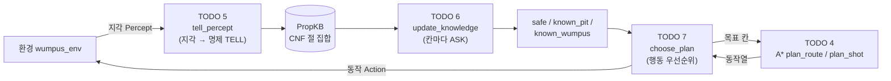

# TODO 4 · 5 · 6 · 7 — 탐색·에이전트 파트 설계 및 구현 노트

> 담당: 탐색·에이전트 (김태은) · 파일: `planner.py`, `agent.py`, `test_search_agent.py`, `tools/exp_search_agent.py`
> PPT 담당 슬라이드: **4. 시스템 구조**, **6. 알고리즘 구현 과정(탐색·에이전트 부분)**. 이 문서를 그대로 슬라이드 원고로 써도 됩니다.

---

## 0. 한눈에 보기



한 턴(`HybridWumpusAgent.__call__`)의 흐름은 교재 그림 7.20 HYBRID-WUMPUS-AGENT와 같습니다.

1. **TELL** — 이번 지각을 KB에 알린다 (TODO 5)
2. **ASK** — KB가 바뀌었으면 16칸 모두에 대해 "구덩이 없음/있음", "웜퍼스 없음/있음"을 묻는다 (TODO 6)
3. **계획** — 남은 계획이 없으면 우선순위에 따라 새 계획을 세운다 (TODO 7, 경로는 A* = TODO 4)
4. **행동** — 계획의 첫 동작을 실행하고, 자기 위치·방향을 스스로 갱신한다 (`apply`)

---

## 1. TODO 4 — A* 경로 계획 (`planner.py: astar`)

### 문제 정의

| 요소 | 정의 |
|---|---|
| 상태 | `(x, y, dir)` — 같은 칸이라도 바라보는 방향이 다르면 다른 상태 (회전에도 비용이 들기 때문) |
| 동작 | `Forward`, `TurnLeft`, `TurnRight`, 비용은 모두 1 (환경의 동작당 −1점과 같음) |
| 제약 | `Forward`는 `allowed`(안전하다고 증명된 칸 + 방문한 칸)로만 갈 수 있음 |
| 목표 | `goal_test(state)` — 목표 칸 집합 중 하나에 도착 (사격 계획은 "특정 방향을 바라보는 상태") |
| 휴리스틱 | `h = 가장 가까운 목표 칸까지의 맨해튼 거리` |

### 휴리스틱이 허용적·일관적인 이유

- 칸을 한 칸 옮기려면 `Forward`가 최소 1번 필요 → 남은 비용 ≥ 맨해튼 거리 → **허용적(admissible)**
- `Forward` 1회는 맨해튼 거리를 최대 1만 줄이고, 회전은 거리를 바꾸지 않음 → `h(s) ≤ 1 + h(s')` → **일관적(consistent)**
- 일관적이므로 한 번 확장(closed)한 상태는 다시 열 필요가 없고, A*가 찾은 경로는 **최적**

### 구현 요점

```python
frontier = [(h(start), tie, 0, start)]      # (f, 동점 처리 카운터, g, 상태)
best_g   = {start: 0}
parent   = {start: None}                     # 상태 → (이전 상태, 동작)
while frontier:
    f, _, g, s = heappop(frontier)
    if g > best_g[s] or s in closed: continue   # 낡은 원소 버리기 (lazy deletion)
    if goal_test(s): return 역추적(parent, s)    # 꺼낼 때 목표 검사 → 최적성 보장
    closed.add(s); stats["expanded"] += 1
    for a, s2 in successors(s, allowed):
        if g + 1 < best_g.get(s2, ∞):            # 더 짧은 경로를 찾으면 갱신
            best_g[s2] = g + 1; parent[s2] = (s, a)
            heappush(frontier, (g + 1 + h(s2), tie, g + 1, s2))
return None
```

- **동점 처리 카운터(`itertools.count`)**: f가 같을 때 상태 튜플끼리 비교하지 않게 하고 결과를 항상 같게(결정적) 만든다.
- **목표 검사 시점**: 넣을 때가 아니라 *꺼낼 때* 검사해야 최적 경로를 보장한다.
- **여러 목표**: `plan_route`는 미방문 안전 칸 전체를 목표로 넘긴다 → A* 한 번으로 "동작 수 기준 가장 가까운 칸"을 찾는다. (칸마다 A*를 돌리는 것보다 빠름)

### 검증 (`test_search_agent.py`)

- 무작위 허용 칸 500개 문제에서 **A* 경로 길이 = 균일 비용 탐색(h=0) 경로 길이** (최적성)
- 계획을 실제로 시뮬레이션해서 허용되지 않은 칸을 밟지 않는지 확인
- 갇힌 경우 `None`, 시작 = 목표면 `[]`

---

## 2. TODO 5 — 지각 → TELL (`agent.py: tell_percept`)

기호는 **비시간적(atemporal)** 입니다: `P{x}{y}` = [x,y]에 구덩이, `W{x}{y}` = [x,y]에 (처음에) 웜퍼스.
에이전트가 위치를 스스로 추적하므로 시간 첨자가 필요 없습니다.

| 지각 / 사실 | TELL 하는 문장 | 이유 |
|---|---|---|
| 현재 칸 c에 살아 있음 | `¬P(c)` | 구덩이였다면 죽었음 |
| 웜퍼스가 살아 있음 | `¬W(c)` | 웜퍼스 칸이었다면 죽었음 (죽은 뒤에는 그 칸에 갈 수 있으므로 말하지 않음) |
| Breeze 있음 | `P(n1) ∨ P(n2) ∨ …` | 규칙 `B_c ⇔ ∨P(이웃)`에 B_c=참 대입 |
| Breeze 없음 | `¬P(n1) ∧ ¬P(n2) ∧ …` | 같은 규칙에 B_c=거짓 대입 |
| Stench 있음 | `W(c) ∨ W(n1) ∨ …` | 환경은 **웜퍼스 칸 자신에서도** 냄새를 준다 (`wumpus_env.percept`) |
| Stench 없음 | `¬W(c) ∧ ¬W(n1) ∧ …` | |
| 화살이 빗나감 | 화살 줄의 모든 칸 `¬W` | 화살은 내 칸부터 벽까지 날아감 |
| Scream | `wumpus_dead = True` | 이후 웜퍼스는 위험 요소가 아님 |

- 규칙 `B ⇔ …` 전체를 TELL하고 `B`를 따로 TELL해도 되지만, 관측값을 **미리 대입**하면 B·S 기호가 KB에 없어져
  기호 수가 줄고(TT는 2^n) 추론이 빨라집니다.
- 같은 칸은 지각이 변하지 않으므로 `told` 집합으로 **한 번만** TELL 합니다.
- 죽은 웜퍼스도 냄새는 남으므로 냄새 규칙은 웜퍼스 생사와 상관없이 항상 참입니다.
- 건전성 검사: `test_agent.py`의 t6이 KB의 모든 절이 실제 세계에서 참인지 확인 → PASS

---

## 3. TODO 6 — ASK로 지식 갱신 (`agent.py: update_knowledge`)

```text
for 각 칸 c:
    if c의 구덩이 여부를 아직 모름:
        ASK(KB, ¬P(c)) → not_pit 에 추가
        아니면 ASK(KB, P(c)) → known_pit 에 추가
    if 웜퍼스 살아 있음 ∧ 위치 미확정 ∧ c의 웜퍼스 여부를 아직 모름:
        ASK(KB, ¬W(c)) → not_wumpus 에 추가
        아니면 ASK(KB, W(c)) → known_wumpus = c, 나머지 모든 칸에 ¬W TELL
safe = not_pit ∩ (not_wumpus 또는 웜퍼스 사망)
```

- **ASK(¬X)가 거짓 ≠ X가 참.** "모른다"일 수 있으므로 `ASK(X)`를 따로 물어야 확정 여부를 압니다.
- **단조성(monotonicity)**: 명제논리에서는 KB에 문장을 더해도 이미 함축된 사실은 그대로입니다.
  그래서 한 번 결정된 칸은 다시 묻지 않습니다 → ASK 횟수 절약.
- **`dirty` 플래그**: KB가 바뀌지 않은 턴(회전만 한 턴 등)에는 ASK를 건너뜁니다.
- **웜퍼스는 정확히 1마리**: 위치가 확정되면 다른 15칸에 `¬W`를 TELL → 이후 추론이 훨씬 쉬워집니다.

예) 그림 7.2 세계에서 [1,1] → [2,1](Breeze) → [1,2](Stench) 를 방문하면
`known_pit = {[3,1]}`, `known_wumpus = [1,3]`, `[2,2]`가 안전 — 교재 7.3절의 추론과 같습니다 (테스트로 확인).

---

## 4. TODO 7 — 행동 결정 (`agent.py: choose_plan`)

| 우선순위 | 조건 | 행동 |
|---|---|---|
| ① | Glitter | `Grab` → A*로 [1,1] → `Climb` |
| ② | 방문하지 않은 안전 칸이 있음 | A*로 **가장 가까운** 안전 칸으로 이동 (TODO 7-②) |
| ③ | 화살 있음 ∧ 웜퍼스 때문에만 막힌 칸이 있음 | **PLAN-SHOT**: 그 칸과 같은 행/열의 안전 칸으로 가서 바라보고 `Shoot` (TODO 7-③) |
| ④ | `--policy risk` | 증명상 확정 위험이 아닌 칸으로 모험 (기본 제공) |
| ⑤ | 그 외 | A*로 [1,1]로 돌아가 `Climb` (빈손 탈출) |

### 7-② 탐험

- 목표 = `safe − visited`, 지나갈 수 있는 칸 = `safe ∪ visited` → 경로 위의 모든 칸이 안전하다고 **증명된** 칸.
- 그래서 `--policy safe`에서는 **사망률 0%** 가 보장됩니다 (무작위 1000개 실험에서 확인).

### 7-③ 사격 (선택 과제, 구현함)

- 사격 후보 = 방문 안 함 ∧ 구덩이 없음(증명) ∧ 웜퍼스 없음은 증명 안 됨
- 웜퍼스 위치가 확정이면 그 칸만 노립니다. 확정이 아니어도 쏩니다:
  - 맞으면 Scream → 웜퍼스 사망 → 막혔던 칸들이 안전해짐
  - 빗나가면 "화살 줄에는 웜퍼스가 없다"를 TELL → 후보 칸이 안전해지거나 웜퍼스 위치가 좁혀짐
- 방문한 칸에 붙은 후보(바로 들어갈 수 있는 칸)를 먼저 고르고, 그중 사격 계획이 가장 짧은 것을 선택
- 화살 −10점 ≪ 금 +1000점이므로 막힌 칸이 있으면 쏘는 것이 기대 점수상 이득
- `HybridWumpusAgent(shoot=False)`로 끌 수 있음 (실험 비교용)

---

## 5. 실험 결과 (`python tools/exp_search_agent.py --plot`)

> ⚠️ 아래 수치는 logic.py TODO 1~3을 **임시 참조 구현**으로 채워 측정한 값입니다.
> 논리 담당의 logic.py가 merge되면 같은 명령으로 다시 돌려 PPT에 넣어 주세요. (추론 결과는 같아야 하므로 성공률 등은 동일할 것)

### 실험 1. 사격 × 정책 (무작위 세계 1000개, seed 0~999)

| 정책 | 사격 | 성공률(%) | 해결 가능 세계(747개) 중 성공률(%) | 사망률(%) | 평균 점수 | 평균 동작 수 | 화살 사용 |
|---|---|---|---|---|---|---|---|
| safe | X | 27.3 | 36.5 | **0.0** | 263.3 | 9.7 | 0 |
| safe | **O** | **37.2** | **49.8** | **0.0** | **358.1** | 12.0 | 198 |
| risk | X | 37.6 | 50.3 | 56.6 | −202.1 | 12.1 | 0 |
| risk | O | 47.5 | 63.6 | 48.5 | −26.4 | 14.1 | 227 |

해석
- **사격(7-③) 덕분에 safe 정책 성공률이 27.3% → 37.2%(+9.9%p), 평균 점수 +95점.** 사망은 여전히 0건.
- risk 정책은 성공률은 높지만 절반가량 죽어서 평균 점수가 음수 → 기대 점수 기준으로는 safe가 합리적.
- "해결 가능 세계"(`gold_reachable`)는 구덩이만 피하면 금에 갈 수 있는 세계 — 성공률 100%가 불가능한 이유.
  safe 에이전트가 나머지를 못 푸는 이유는 **증명 가능한 안전 칸이 없어서** (예: 시작하자마자 Breeze).

### 실험 2. A* vs 균일 비용 탐색 (무작위 경로 문제 1000개)

| 알고리즘 | 평균 확장 노드 수 | 경로 길이 |
|---|---|---|
| 균일 비용 (h=0) | 12.31 | 최적 |
| A* (맨해튼) | **7.79** (−36.7%) | 최적 (모든 문제에서 길이 동일) |

### 그림 7.2 세계 실행 (`python main.py --world worlds/world_fig7_2.txt --verbose`)

결과: 성공, 점수 978, 동작 22회, 방문 6칸. 경로 [1,1]→[2,1]→[1,1]→[1,2]→[2,2]→[3,2]→[2,2]→[2,3](금)→[2,2]→[2,1]→[1,1].

### 사격 세계 (`worlds/world_shoot.txt`)

사격 없으면 빈손 탈출, 사격하면 웜퍼스를 잡고 금 회수 (점수 951) — `test_search_agent.py`로 확인.

---

## 6. 테스트

```bash
python test_agent.py            # 공식 자가 점검 (필수 7개)
python test_search_agent.py     # 탐색·에이전트 파트 추가 테스트 10개
```

`test_search_agent.py`의 A*/PLAN-SHOT/TELL 테스트 6개는 logic.py 없이도 돌아가고,
ASK·행동 테스트 4개는 logic.py(TODO 1~3)가 없으면 SKIP 으로 표시됩니다.

## 7. 더 해볼 수 있는 것 (보고서 '문제점 및 개선방향' 후보)

- **위험 최소화 모험**: risk 정책을 "구덩이 확률"(교재 12장 확률 추론)로 고르면 사망률을 줄일 수 있음
- **기대 효용 기반 귀환**: 남은 안전 칸이 멀고 금 가능성이 낮으면 일찍 귀환
- **증분 추론**: 매 턴 16칸 × 최대 4번 ASK 대신, 새 절과 관련된 칸만 다시 ASK
- **탐험 과정 애니메이션**: `world.trajectory`를 프레임별로 그려 GIF로 저장 (발표용)
